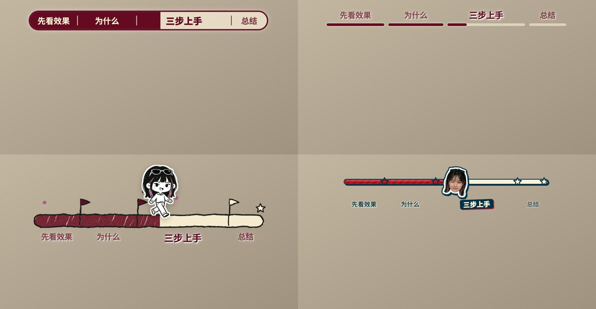

# 章节进度条 chapter-progress-bar

版本 1.16（2026-11-20）

给口播、教程类视频加一根会往前走的章节进度条，让观众知道讲到哪了、还剩多少。这是一个给 AI Agent 用的 skill（Claude Code、Codex 等都能用）：你用大白话告诉 Agent 要什么，它照这个 skill 帮你出片。



| 样式 | 样子 | 角色 |
|---|---|---|
| **A 空心横条** | 描边的空心横条，章节名写在条里，颜色从左往右一直推 | 无 |
| **B 分段细条** | 每章一段细条，章节名在段上方，当前段逐步填满 | 无 |
| **C 手绘条** | 勾线手绘管子 + 蜡笔涂色 + 小旗 | **你自己的**走路小人 |
| **D 美式复古条** | 描边细条 + 硬投影 + 流动条纹 + 星星 | **你自己的**表情头像压在条上跟着走，甩头时换表情 |

> 上图 C、D 里是作者 Raylin 的形象，只是示范。**用 C、D 前要先上传你自己的形象**（见下文「第一步」），skill 里没有可以直接用的角色。A、B 装好就能用。

- 配色可以换：内置 6 套，也可以给色值或色卡图。
- 抖音 / TikTok / 小红书的竖屏安全区会自动避开，出片前会检查，进度条出界就不出片。
- 9:16、3:4、4:5、1:1、4:3、16:9 都能用：给视频时按视频画幅自动排版，没有视频就自己选画幅。
- 两种出片方式：让 Agent 直接叠进视频里；或导出透明 MOV / 绿幕 MP4，拖进剪映、Premiere、Final Cut、达芬奇。

## 安装

1. **把整个 `chapter-progress-bar` 文件夹放进 Agent 的 skills 目录**。
   - Claude Code：`~/.claude/skills/chapter-progress-bar/`
   - 其他 Agent：放进它读 skill 的目录，具体位置看该 Agent 的说明。
2. **装好三样工具**：[Google Chrome](https://www.google.com/chrome/)（Edge、Chromium 也行）、[Node.js](https://nodejs.org/) 22 或更新版本、[ffmpeg](https://ffmpeg.org/download.html)。
   - macOS：`brew install node ffmpeg`，再装 Chrome。
   - Windows：`winget install OpenJS.NodeJS Gyan.FFmpeg`，Chrome 或 Edge 用系统自带的就行。
   - Linux：用发行版的包管理器装 `nodejs`、`ffmpeg`、`chromium`。

   出片和给形象抠图都用这三样，macOS、Windows、Linux 都能用。在 Mac 上，抠图会自动改用系统自带的方式（需要 Xcode 命令行工具：`xcode-select --install`；没装也没关系，会自动改用 Chrome）。

装完新开一个 Agent 会话就能用。

## 第一步：上传你自己的形象（用 C、D 前必做）

跟 Agent 说「我要用手绘小人进度条」或「我要用表情头像进度条」。它会先查你有没有做过形象，没有的话会发你一段提示词：把它和一张你的正面照一起发给任意 AI 生图工具（即梦、豆包、ChatGPT 等），生成好发回给 Agent 就行。手上已经有现成的图，也可以直接发。提示词在 `prompts/形象生成提示词.md`，不用改，发型、发色、配饰都从你的照片里取。

| | C 走路小人 | D 表情头像 |
|---|---|---|
| 示范 | `examples/示范形象/走路小人示范.jpg` | `examples/示范形象/表情头像示范.jpg` |
| 准备 | 2 张同一个小人朝右走路的迈步图（左脚在前、右脚在前），全身，同样的衣服 | 1–5 张同一个人的不同表情，头像切到脖子，正脸 |
| 背景 | 白底，或透明底 PNG | 白底，或透明底 PNG |
| 清晰度 | 400px 高以上 | 400px 高以上 |
| 要告诉 Agent | 角色叫什么 | 换表情的顺序；角色叫什么 |

你把图发回来以后，Agent 会帮你抠图，存进 `~/Documents/进度条角色/<名字>/`，并给你一张预览图，用来检查抠得干不干净，你确认后就做好了。以后说名字就能用；这个类型只有一个角色的话，名字都不用说。

你的图只存在你自己电脑上，不会写进这个 skill，分享 skill 时也不会带出去。

## 怎么用

跟 Agent 说一句，比如：

- 「给这个视频加章节进度条」，再附上视频
- 「导出一条 9:16 的进度条，我要放进剪映」
- 「用我的走路小人，给这期加进度条」

Agent 会先发一张 4 种样式的样例图让你选，再问章节名和时间；问配色时会发一张你选的样式在 6 套配色下的样例图，让你看着选；也可以直接发一张色卡图（品牌色板、喜欢的海报都行），它会从图里取色配好，没给视频时还会问画幅。选了 C、D 但还没有你的形象时，它会先带你做第一步。然后它出一张**检查图**给你看，图上的蓝框是安全区。你确认了它才出整条。

### 给小红书口播视频加进度条

把原片发给 Agent，或提供它能读取的文件路径。把下面的章节名和时间换成你自己的，再把整段话发过去。

```text
帮我给这条小红书竖屏口播加章节进度条。用 B 分段细条，配色选海军蓝，放在视频顶部的安全区内。

00:00–00:08 先看成品
00:08–00:38 实操演示
00:38–片尾 总结

先发检查图给我看。我确认后，把进度条叠到原片上，导出成片 MP4，保留原声。
```

### 只有字幕，没有视频

只把字幕文件发给 Agent 也行：SRT、VTT，或带时间的 TXT。它会按字幕算出视频有多长，从字幕里找出章节（剪映里挂在画面上的章节标题、「一.」「二.」这类编号都能认），再做一条一样长的进度条给你，你拖进剪辑软件叠在视频上就行。

```text
这是我视频的字幕，帮我做一条 9:16 的章节进度条，用 B 分段细条，导出透明底 MOV，我要放进剪映。
```

- Agent 会先问你视频是什么画幅（9:16、3:4、16:9 等）。字幕里看不出画面尺寸，这一步不能省。
- 字幕里没有章节标题时，Agent 会读台词帮你分章，再给你确认。
- 视频比最后一句字幕长（片尾有空镜、音乐）时，告诉它实际时长。
- 只有纯文字稿、没有时间的话，要告诉它视频时长，每章的时间只能按字数估个大概。从剪映导出 SRT 字幕更准（导出 → 字幕 → SRT）。
- 放进剪辑软件时，进度条从第 0 秒和视频对齐。

**放进剪辑软件**：
- 剪映电脑版、Premiere、Final Cut、达芬奇：用透明 MOV，放在视频上面一层，位置不用调。
- 剪映手机版这类只认 MP4 的：用绿幕 MP4，放上层后用「色度抠图」吸掉绿色。

## 注意

- 出片用无头 Chrome 逐帧画图。**在 Claude 桌面端里要在终端里运行**（桌面端的沙盒里起不了 Chrome）。Agent 会自动在终端标签页里跑，你点同意就行。
- 1 分钟的片子大约出 2 分钟。透明 MOV 很大：B 样式 1 分钟约 300 MB，C 样式有手绘纹理，1 分钟约 700 MB。
- 安全区数值在 `safe-zones.json`，按目前公认的抖音 / TikTok / 小红书竖屏安全区设定。平台改版了可以自己改。
- 主要在 macOS 上测试过。Windows、Linux 上会自动去常见位置找 Chrome / Edge / Chromium；找不到就用环境变量 `CHROME` 指过去。

## 素材版权

- 代码：MIT（跟随仓库）。
- 字体 `assets/fonts/NotoSansSC-VF.ttf`：思源黑体，SIL Open Font License 1.1，见 `字体许可.txt`。
- `预览.jpg`、`配色样例/`、`examples/示范形象/`：作者 Raylin 本人的形象，只用来示范，请不要用于其他用途。

## 文件

```
chapter-progress-bar/
  SKILL.md                给 Agent 看的完整说明（流程、配置字段、规则）
  README.md               这份
  预览.jpg                4 种样式的样例
  配色样例/               每种样式在 6 套配色下的样子
  scripts/render.mjs      出片脚本
  scripts/renderer.html   4 种样式的画法
  scripts/prepare_character.mjs  把你的图做成角色（按设备选抠图方式）
  scripts/cutout.swift、cutout.html   抠图：macOS 用 swift，其他系统用 Chrome
  scripts/browser.mjs     启动无头 Chrome（出片、抠图共用）
  scripts/palette.mjs     从你的色卡图里取色
  scripts/subtitles.mjs   只有字幕时，按字幕算时长、找章节
  themes/themes.json      配色
  safe-zones.json         安全区
  examples/               示例配置
  examples/示范形象/       该准备什么样的图（作者 Raylin 的形象，只作示范）
  prompts/                请你上传形象时用的两段提示词
  assets/fonts/           思源黑体（SIL Open Font License，见 字体许可.txt）
```
